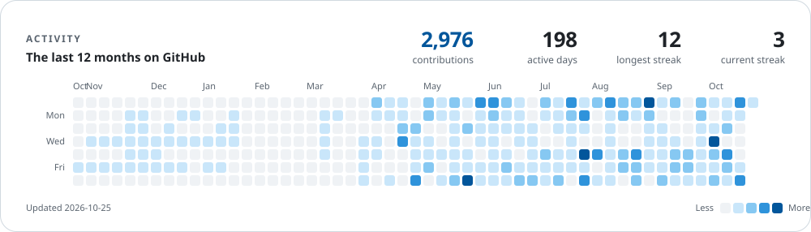

<picture>
  <source media="(prefers-color-scheme: dark)" srcset="assets/hero-dark.svg">
  
</picture>

<a href="https://www.linkedin.com/in/recep-ek%C5%9Fi-473b29222/"><picture><source media="(prefers-color-scheme: dark)" srcset="assets/link-linkedin-dark.svg"></picture></a>&nbsp;&nbsp;<a href="mailto:recept2534@gmail.com"><picture><source media="(prefers-color-scheme: dark)" srcset="assets/link-email-dark.svg"></picture></a>&nbsp;&nbsp;<a href="https://claude.ai/artifact/N6kbh5FJF5Za92iXwUSKqC"><picture><source media="(prefers-color-scheme: dark)" srcset="assets/link-portfolio-dark.svg"></picture></a>&nbsp;&nbsp;<a href="https://recipely.net/about"><picture><source media="(prefers-color-scheme: dark)" srcset="assets/link-recipely-dark.svg"></picture></a>

I build mobile apps that stay easy to change years later: a fintech super app, a bank's payment SDK, white-label learning apps for enterprise brands, and [Recipely](https://recipely.net/about) on iOS, Android and the web.

<picture>
  <source media="(prefers-color-scheme: dark)" srcset="assets/stack-dark.svg">
  
</picture>

 

<picture>
  <source media="(prefers-color-scheme: dark)" srcset="assets/activity-dark.svg">
  
</picture>

 

