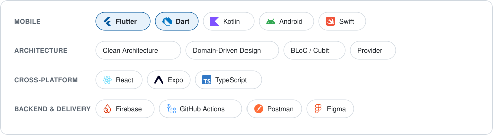
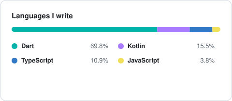

# Recep Ekşi

**Mobile Development Team Lead · Senior Flutter & Android Developer**

I build Flutter apps that stay easy to change years later — Domain-Driven Design and
Clean Architecture underneath, smooth and accessible screens on top.

[LinkedIn](https://www.linkedin.com/in/recep-ek%C5%9Fi-473b29222) · [Email](mailto:recep2534@gmail.com) · [Recipely](https://recipely.net)

---

### Flutter, the way I build it

- **Layered on purpose.** Domain, application, infrastructure and presentation are separate layers with
  rules about who may import whom; entities and value objects hold the business rules, not the widgets.
- **State you can reason about.** BLoC / Cubit with explicit, named states — loading, loaded, failed — never
  a handful of booleans that can contradict each other.
- **Errors are values.** Failures travel as results, so every screen decides what the user sees when
  something goes wrong.
- **One codebase, every screen size.** Phones, tablets, foldables and the web from the same Flutter app.
- **Leading the team around it.** Code review, CI gates and a shared architecture so a growing team keeps
  shipping without breaking what already works.

### Featured work

<table>
<tr>
<td width="50%" valign="top">

**[LGS Ödül Avı](https://github.com/recepteksi/lgs_reward_hunt)** · Flutter 
A parent-controlled, gamified study app for students preparing for the LGS exam: daily tasks, points,
rewards a parent approves. Clean Architecture + DDD.

</td>
<td width="50%" valign="top">

**[Workout Planner](https://github.com/recepteksi/workout-planner)** · Flutter 
Manages workout programs on Android and the web, and tells you which program to train next.
[Live on the web](https://workout-planner-web.web.app).

</td>
</tr>
<tr>
<td width="50%" valign="top">

**[BriefAI](https://github.com/recepteksi/briefai)** · Flutter 
An AI email assistant for mobile: spoken daily briefings, tiered smart notifications and suggested
replies.

</td>
<td width="50%" valign="top">

**[Shartflix](https://github.com/recepteksi/shartflix)** · Flutter 
A case study in enterprise Flutter architecture: four DDD layers, value objects, Cubit, and one codebase
for Android, iOS, web, Windows and macOS.

</td>
</tr>
<tr>
<td width="50%" valign="top">

**[ARSample](https://github.com/recepteksi/ARSample)** · Kotlin Multiplatform 
Augmented-reality object placement on Android and iOS (ARCore / ARKit), with Compose Multiplatform,
Clean Architecture and DDD.

</td>
<td width="50%" valign="top">

**[Recipely](https://recipely.net)** · React Native · TypeScript 
A recipe app on iOS, Android and the web: import from social media, cook hands-free with a voice
assistant, plan meals. Built on the same DDD layering.

</td>
</tr>
</table>

### Tech stack

<picture>
  <source media="(prefers-color-scheme: dark)" srcset="assets/stack-dark.svg">
  
</picture>

### On GitHub

  <picture>
    <source media="(prefers-color-scheme: dark)" srcset="assets/activity-dark.svg">
    
  </picture>
  <picture>
    <source media="(prefers-color-scheme: dark)" srcset="assets/languages-dark.svg">
    
  </picture>

These cards are generated by this repository's own daily workflow (<code>scripts/</code>), not by an outside
service, so they cannot go missing.

---

<em>"Architecture is the decisions that you wish you could get right early in a project."</em>

